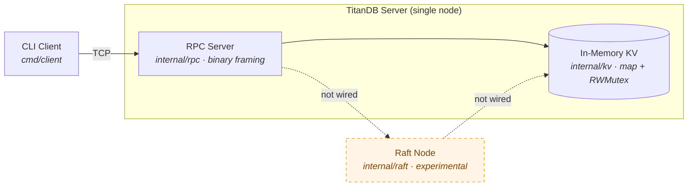

<div align="center">

# TitanDB

**An experimental distributed key-value store built from scratch in Go**

[](https://go.dev/)
[](./LICENSE)
[](https://github.com/kauand3v/titan-db/actions/workflows/ci.yml)
[]()

*TCP networking · binary protocol · concurrency · consensus*

</div>

---

> [!WARNING]
> **Experimental project — not production-ready.**
> The current implementation provides a TCP-based key-value request path backed by an in-memory map. The Raft package is still a prototype: replicated log entries, majority-based commits, durable storage, and end-to-end multi-node consensus are **not implemented**. Do not use TitanDB to store production or valuable data.

---

## Table of contents

- [Overview](#overview)
- [Architecture](#architecture)
- [Project status](#project-status)
- [Quick start](#quick-start-single-node-prototype)
- [Binary protocol](#binary-protocol)
- [Repository layout](#repository-layout)
- [Current limitations](#current-limitations)
- [Roadmap](#roadmap)
- [Testing and quality checks](#testing-and-quality-checks)
- [Non-goals](#non-goals-for-the-current-prototype)
- [Contributing](#contributing)
- [License](#license)
- [Author](#author)

---

## Overview

**TitanDB** is a learning-oriented systems project that explores how a small storage service can be built from lower-level primitives — a raw TCP socket, a hand-rolled binary wire format, careful concurrency, and an incremental path toward Raft consensus — instead of relying on an HTTP framework or a managed database.

The current Go implementation includes:

- A **TCP server** and a **custom binary request protocol** (no HTTP, no gRPC).
- A **command-line client** supporting `PUT`, `GET`, `DELETE`, plus an experimental `3SUM` demo.
- A thread-safe **in-memory key-value store** protected by `sync.RWMutex`.
- An early **Raft scaffold** (`internal/raft`) with node roles, election timers, vote-request handling, and heartbeat-related code.

The project is developed incrementally. Its current state is a **prototype for learning and experimentation**, not a complete distributed database.

---

## Architecture

TitanDB is layered as: **client → binary RPC → in-memory store**. The `internal/raft` package exists as an experimental consensus scaffold but is **not yet wired into the request path** — incoming writes go directly to the local map instead of being appended to a replicated log and committed by a cluster majority.



<details>
<summary>ASCII fallback (for viewers without Mermaid)</summary>

```text
┌──────────────────┐
│   CLI Client     │
└────────┬─────────┘
         │ TCP
         ▼
┌──────────────────────────┐
│   TitanRPC Server        │
│   binary framing         │
└────────────┬─────────────┘
             │
             ▼
┌──────────────────────────┐
│   In-memory Key-Value    │
│   map + sync.RWMutex     │
└──────────────────────────┘

┌──────────────────────────┐
│   internal/raft          │  ← experimental, not wired
│   election · heartbeat   │
└──────────────────────────┘
```

</details>

### Main packages

| Package | Responsibility |
|---|---|
| `cmd/server` | Starts a TitanDB server node and its supporting components. |
| `cmd/client` | Sends key-value commands to a server over TCP. |
| `internal/rpc` | Encodes/decodes application requests and handles TCP connections. |
| `internal/kv` | Provides the in-memory key-value store. |
| `internal/raft` | Experimental Raft node and election/heartbeat code. |
| `pkg/logger` | Project logging utilities. |

---

## Project status

| Component | Status |
|---|:---:|
| TCP server & binary framing | ✅ Implemented |
| CLI client (`PUT` / `GET` / `DELETE`) | ✅ Implemented |
| Thread-safe in-memory store | ✅ Implemented |
| `3SUM` demo command | 🟡 Experimental |
| Raft node roles & election scaffold | 🟡 In progress |
| `AppendEntries` log replication | ❌ Not implemented |
| Majority-based commit | ❌ Not implemented |
| Write-ahead log & snapshots | ❌ Not implemented |
| Crash recovery / durable storage | ❌ Not implemented |
| Multi-node consensus (end-to-end) | ❌ Not implemented |
| Production security & hardening | ❌ Not implemented |

> A successful write is stored **only in the process-local map** and is lost when the process exits. No replicated or durable writes exist today.

---

## Quick start (single-node prototype)

These commands exercise the current single-node TCP/RPC and in-memory key-value path. They **do not** demonstrate replicated writes or multi-node Raft consensus.

### 1. Clone the repository

```bash
git clone https://github.com/kauand3v/titan-db.git
cd titan-db/titan-db
```

> The Go module currently lives in the `titan-db/` subdirectory. See the [roadmap](#roadmap) for the planned move to the repository root.

### 2. Start a server node

```bash
go run ./cmd/server/main.go \
  --id=1 \
  --address=127.0.0.1:8001 \
  --cluster=1@127.0.0.1:8001
```

### 3. Write, read, and delete

In a second terminal, from the same `titan-db/titan-db` directory:

```bash
go run ./cmd/client/main.go \
  --server=127.0.0.1:8001 \
  --cmd=PUT \
  --key=greeting \
  --val=hello
```

```bash
go run ./cmd/client/main.go \
  --server=127.0.0.1:8001 \
  --cmd=GET \
  --key=greeting
```

```bash
go run ./cmd/client/main.go \
  --server=127.0.0.1:8001 \
  --cmd=DELETE \
  --key=greeting
```

### 4. Experimental `3SUM` demo (optional)

Reads integer values from the in-memory store and searches for unique triplets summing to zero. **Not part of the core KV interface.**

```bash
go run ./cmd/client/main.go \
  --server=127.0.0.1:8001 \
  --cmd=3SUM
```

---

## Binary protocol

Every application request starts with a **fixed 9-byte header**, followed by a variable-length payload. All multi-byte integers are **big-endian**.

| Field | Size | Description |
|---|---:|---|
| Payload length | 4 bytes | Length of the request payload. |
| Message ID | 4 bytes | Request identifier (echoed back in the response). |
| Command | 1 byte | Operation code. |
| Payload | Variable | Command-specific data. |

### Command codes

| Code | Command | Payload layout |
|---:|---|---|
| `1` | `PUT` | `keyLen · key · valLen · value` |
| `2` | `GET` | `keyLen · key` |
| `3` | `DELETE` | `keyLen · key` |
| `4` | `3SUM` | *(none — demo operation)* |

> The protocol is a **work in progress** and should not be treated as a stable public specification. It will be versioned and unified with the Raft transport in a future phase.

---

## Repository layout

```text
titan-db/
├── README.md
├── ruby/                      # Experimental Ruby client material
└── titan-db/                  # Current Go module
    ├── cmd/
    │   ├── client/
    │   └── server/
    ├── internal/
    │   ├── kv/
    │   ├── raft/
    │   └── rpc/
    ├── pkg/
    │   └── logger/
    └── go.mod
```

The layout is being simplified. The long-term goal is to **move the Go module to the repository root** and keep optional language clients under a clearly named `clients/` directory.

---

## Current limitations

Known from the current source tree:

- **In-memory only.** The KV store is a Go map guarded by a `RWMutex`. Its `Close` method does not persist data.
- **No durable log.** No write-ahead log or snapshot-based recovery path.
- **No replicated write path.** The RPC server applies `PUT`/`DELETE` directly to its local store; Raft's `SubmitCommand` is never used by the request handler.
- **Raft transport is not integrated.** Raft uses a 5-byte message header while the application RPC server decodes a 9-byte header; accepted connections are never dispatched to `HandleRaftConnection`.
- **`AppendEntries` is incomplete.** The handler updates node state and replies, but does not validate or append log entries.
- **No production security.** No authentication, authorization, transport encryption, resource limits, or operational hardening.
- **No stable compatibility contract.** The wire protocol may change.

Because of these limitations, any "multi-node cluster" or "failover" language should only be documented as working **after automated integration tests demonstrate it**.

---

## Roadmap

Ordered around **correctness before performance**.

### Phase 0 — Foundation
- [ ] Move the Go module to the repository root and update the module path to `github.com/kauand3v/titan-db`.
- [ ] Add a `LICENSE` file (MIT).

### Phase 1 — Tests & CI
- [ ] Unit tests for protocol encoding/decoding (truncated messages, oversized payloads).
- [ ] Unit tests for KV operations under concurrency.
- [ ] Integration tests for TCP server + CLI client (`PUT`/`GET`/`DELETE`).
- [ ] GitHub Actions CI running `go vet` and `go test -race ./...`.

### Phase 2 — Single-node durability
- [ ] Write-ahead log (WAL) with fsync, per-entry checksum, and recovery on restart.
- [ ] Snapshots and log compaction.
- [ ] Crash test: write → `kill -9` → restart → verify data survived.

### Phase 3 — Raft consensus
- [ ] Define a single, versioned transport framing for client and Raft traffic — or use separate listeners with explicit protocol handling.
- [ ] Integrate Raft message handling with the server's networking layer.
- [ ] Complete `RequestVote` handling (term and log-freshness rules).
- [ ] Implement `AppendEntries` with `prevLogIndex`/`prevLogTerm` validation and real log replication.
- [ ] Majority-based commit and apply of committed entries to the state machine.
- [ ] Route client writes through `SubmitCommand`; leader-only acceptance with follower redirect/forward.
- [ ] Persist `currentTerm`, `votedFor`, and the log (reusing the WAL).

### Phase 4 — Prove correctness
- [ ] Multi-node integration tests: leader election, replication, leader failure, network partition, node restart.
- [ ] In-memory simulated network (drops, delays, reorders) for deterministic tests.
- [ ] *Optional:* linearizability checking with [`porcupine`](https://github.com/anishathalye/porcupine).

### Phase 5 — Polish
- [ ] `docker-compose.yml` that brings up a 3-node cluster with `make demo`.
- [ ] `docs/ARCHITECTURE.md` with diagrams, decisions, and trade-offs.
- [ ] Benchmarks (throughput, latency, resource usage) with a table in the README.
- [ ] Authentication, transport security, and configurable resource limits.

---

## Testing and quality checks

Automated coverage is the required next step. Once test packages exist, run from the Go module directory:

```bash
go test ./...
go test -race ./...
go vet ./...
```

> A successful build — or a test run with **zero test cases** — is **not** proof of Raft correctness. Distributed-systems claims require multi-process integration tests that verify replicated state and failure behavior.

---

## Non-goals (for the current prototype)

- Replacing Redis, etcd, FoundationDB, or any production database.
- Providing production-grade durability or availability.
- Offering a stable client SDK or wire protocol.
- Claiming linearizability or fault tolerance **before those properties are tested**.

---

## Contributing

Issues and focused contributions are welcome. Before implementing a major feature, please open an issue describing:

1. The problem being addressed.
2. The expected behavior.
3. The design and relevant trade-offs.
4. The tests that will demonstrate correctness.

Keep pull requests small and include tests for protocol, storage, concurrency, and failure-handling changes.

---

## License

No `LICENSE` file is present yet. Until one is added, the project should **not** be assumed to grant permission to reuse, modify, or redistribute its code. The plan is to adopt **MIT** — see Phase 0 in the [roadmap](#roadmap).

---

## Author

**Kauan Oliveira** — [@kauand3v](https://github.com/kauand3v)

> TitanDB is an educational systems project under active development. Documentation describes the current prototype and planned work separately; features are only promoted to **implemented** after they are present in code and covered by reproducible tests.
